<p align="center">
  
</p>

<h1 align="center">拾忆</h1>

<p align="center">捡起被遗忘的 · 让项目更完整</p>

<p align="center">
  <a href="https://github.com/LJS1124/shiyi-desktop/actions/workflows/test.yml"></a>
  
  
  
  
</p>

拾忆是一个 macOS 和 Windows 桌面应用，管理随手冒出来的想法、工作和生活里的项目，并把它们连成一张知识图谱。

**你和你的 AI 助手用的是同一份数据。** 界面给人用；`shiyi` 命令行给 AI 用，Claude Code、Codex 这类助手装上技能说明就会操作。AI 做的每一处修改都会实时出现在界面里，并记在「操作记录」中，可以一键撤销。数据全部在本机的一个 SQLite 文件里。

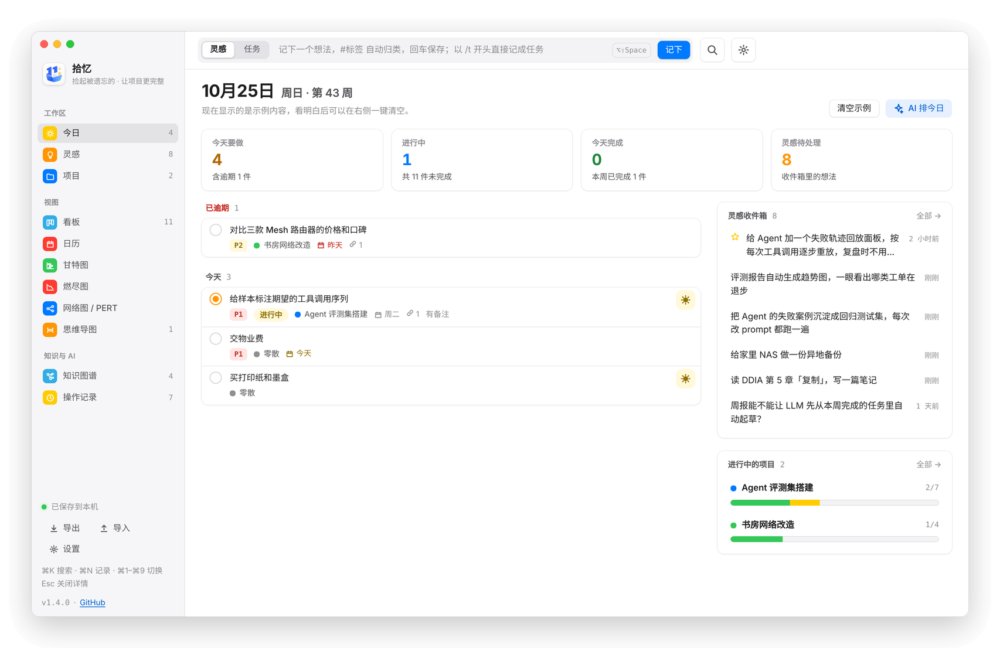

## 亮点

- **随手记，不打断手头的事**：在任何应用里按 <kbd>⌥</kbd><kbd>⇧</kbd><kbd>Space</kbd>（Windows 上是 <kbd>Ctrl</kbd><kbd>Alt</kbd><kbd>Space</kbd>）唤出记录框；`#标签` 自动归类，`[[标题]]` 双链到别的条目。记下的时候会提示「可能和哪条相关」，这一步只比较文字，不调用 AI。
- **一个项目，五种视图**：看板、甘特图、燃尽图、网络图（PERT）、思维导图，用的是同一份任务数据。依赖、三点估算和关键路径在各个视图之间是连通的。
- **知识图谱**：手动关联、AI 建议、`[[双链]]`、相同标签、项目归属和依赖，都画在一张图上。可以只看某一条周围的局部关系，也可以拖线建立关联。
- **AI 原生，但由你掌控**：外部 AI 助手通过命令行读写；内置的 AI 功能只在你点按钮时运行，结果先预览、改完再写入。AI 建的关联必须等你确认才算数，每一批修改都可以撤销。
- **本地优先**：数据只在本机，每天自动备份；不联网也能用（只有 AI 功能需要联网）。

## 看看它

### 知识图谱

灵感、项目、任务、导图之间的关系一目了然。点一个节点，左上角列出它的所有关系；右上角是 AI 提出、等你确认的关联。

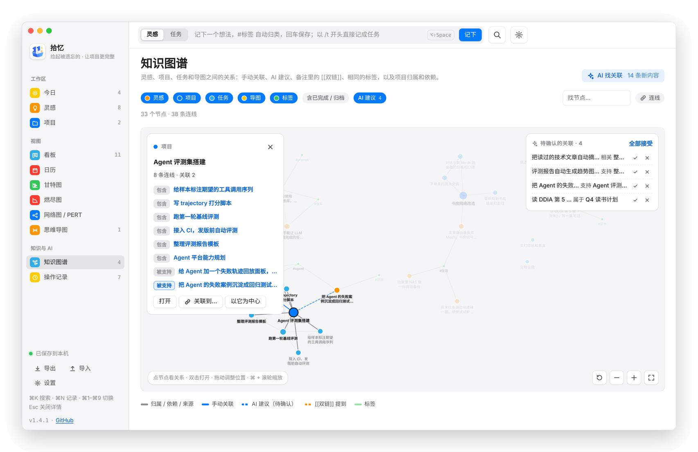

### 记下一条灵感，马上知道它和谁相关

详情面板的「可能相关」按文字相似度挑出候选，一键连上，或标记「不相关」后不再推荐。

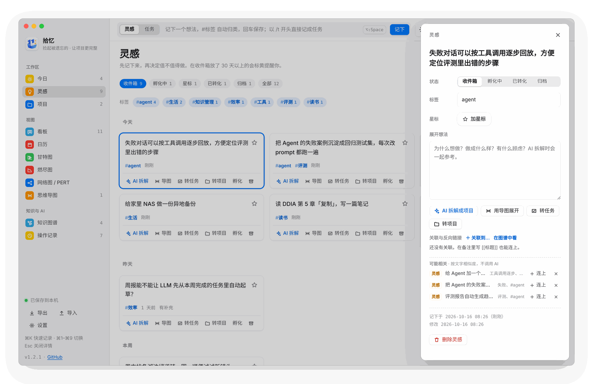

### 项目视图

<table>
  <tr>
    <td width="50%">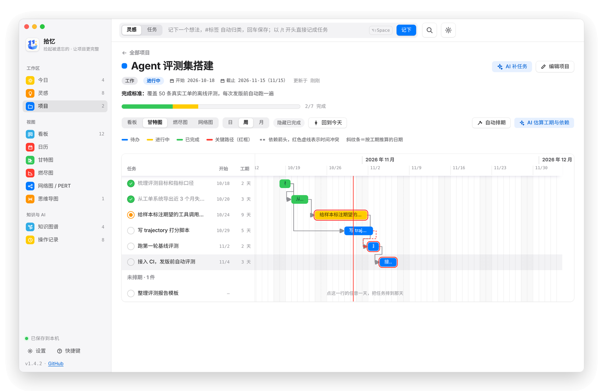<p align="center">甘特图：拖动改日期，依赖箭头，关键路径红框，一键自动排期</p></td>
    <td width="50%">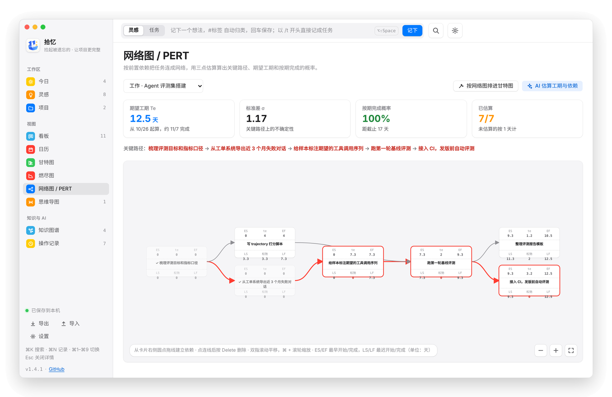<p align="center">网络图 / PERT：三点估算、松弛时间、关键路径、按期完成概率</p></td>
  </tr>
  <tr>
    <td width="50%">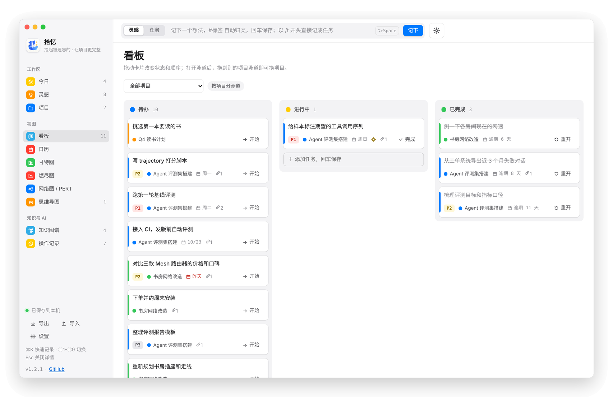<p align="center">看板：拖动改状态和顺序，可按项目分泳道</p></td>
    <td width="50%">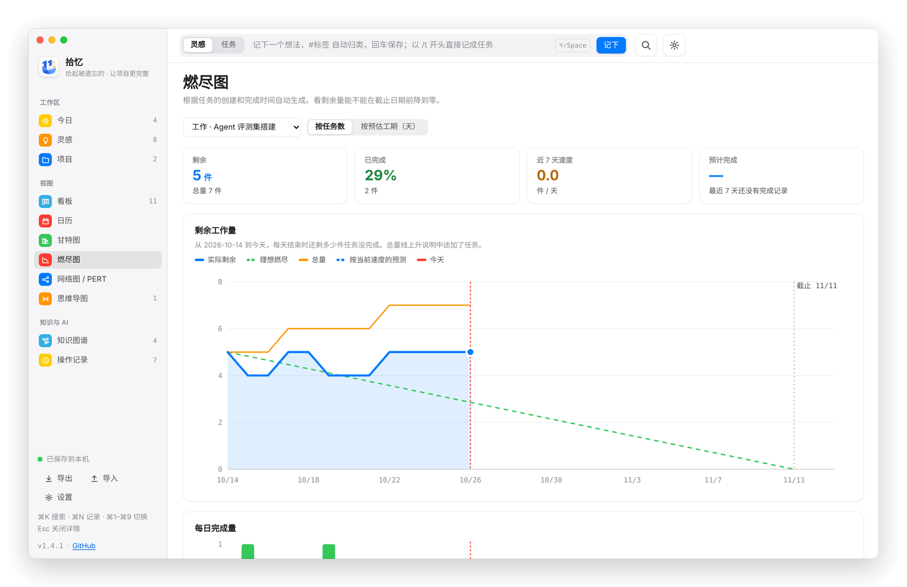<p align="center">燃尽图：实际剩余、理想线、范围变化和按近 7 天速度预测完成日</p></td>
  </tr>
</table>

### 思维导图

<kbd>Tab</kbd> 加子节点，<kbd>Enter</kbd> 加同级节点，拖动可以换父节点。节点或整个分支可以一键转成任务、项目或灵感。

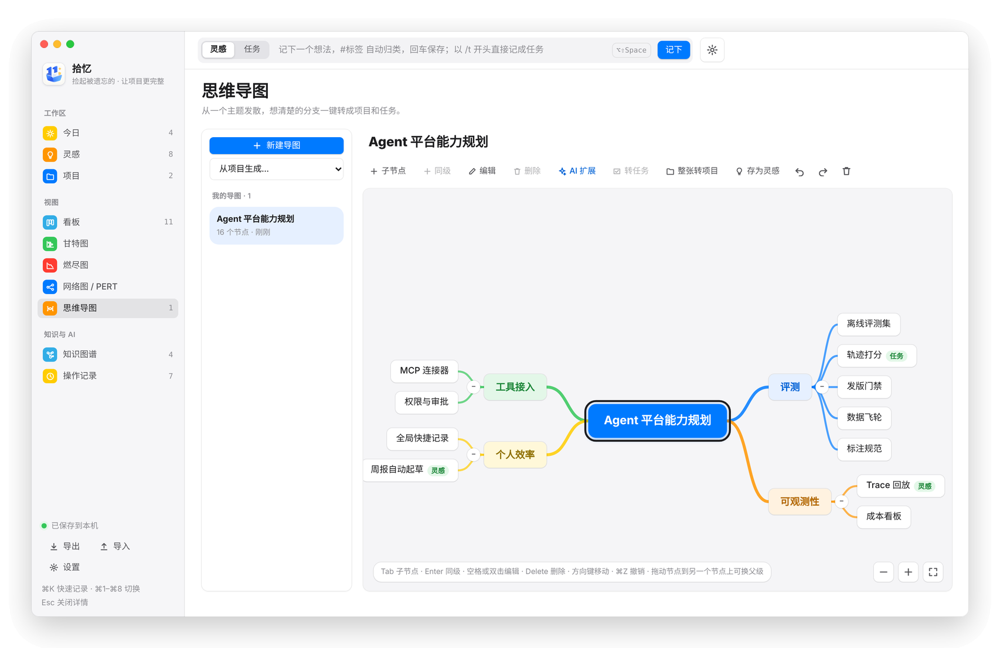

### 操作记录

你在界面里做的修改，和 AI 通过命令行做的修改，都按批次记在这里。同一条内容的连续小改动会自动归成一组，可以按类型、操作筛选，也可以搜索。任意一批都能撤销，撤销也能再撤销。下图下方的提示条，是 AI 刚刚通过命令行加了一个任务。

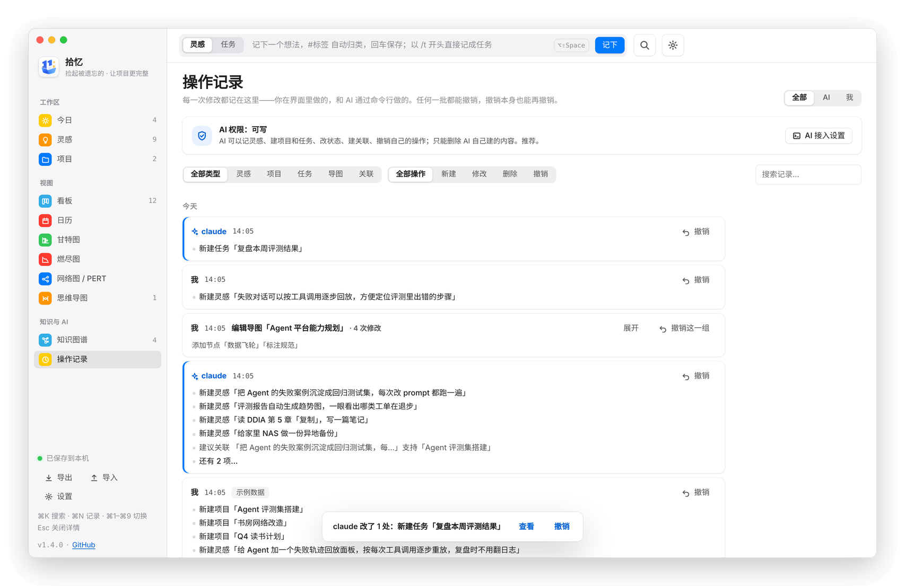

### 深色模式和六种风格

默认是原生风格（macOS 上侧栏是系统的毛玻璃）。「设置 → 外观」里还有素白高密度、暗夜专业、宣纸水墨、新粗野、黏土五种风格，每种都有浅色和深色。

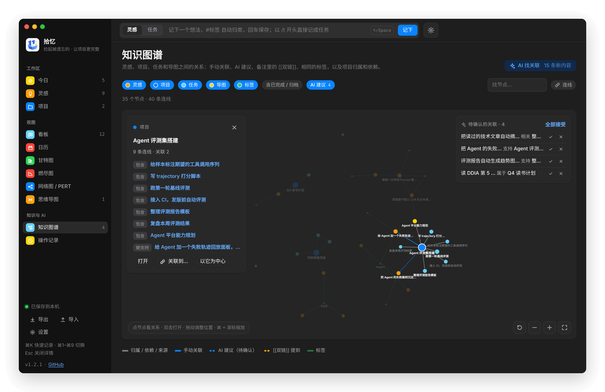

## 让 AI 助手使用拾忆

不需要 MCP，一个命令行加一份技能说明就够了。

1. 打开 **设置 → AI 接入 → 安装命令行工具**，会在 `~/.local/bin/shiyi` 放一个启动脚本（Windows 上是 `%USERPROFILE%\.local\bin\shiyi.cmd`，Git Bash 用同目录下的 `shiyi`）。如果终端里找不到这个命令，把 `~/.local/bin` 加进 PATH；Windows 上安装完成后界面会给出一行可以直接复制的 PowerShell 命令。
2. 点 **安装到 Claude Code**：技能说明会写到 `~/.claude/skills/shiyi/SKILL.md`，Claude Code 会自动读取。其他 AI 可以点「复制技能说明」，粘进它的提示词。
3. 对 AI 说一句「看看拾忆里我今天该做什么」，或者自己在终端运行 `shiyi today --pretty` 试试。

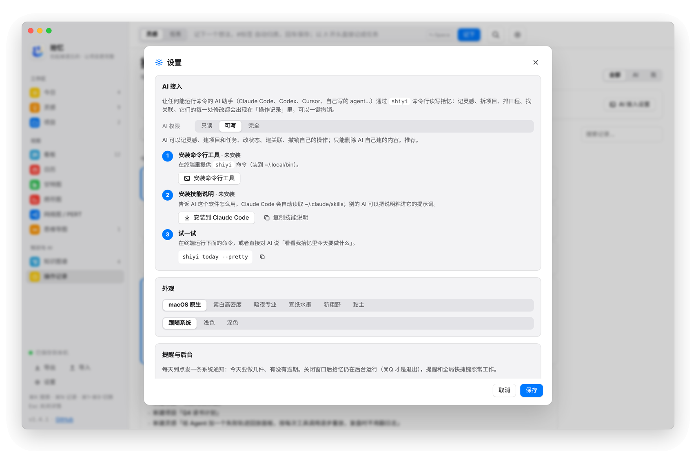

命令行的输入和输出都是 JSON。出错时会返回 `code`、`message`，以及告诉 AI 怎么改的 `hint`：

```bash
shiyi today                                         # 今天要做的、逾期的、收件箱、进行中的项目
shiyi list tasks --status todo,doing --project 网站改版
shiyi get <id 或标题>                               # 详情 + 反向链接 + 依赖
shiyi search 暗色 模式
shiyi related <id 或标题>                           # 可能相关的条目（本地文字相似度，不调 AI）
shiyi graph --center <id> --depth 2                 # 知识图谱
shiyi idea add "周末去看红叶" --tag 旅行 --as claude
shiyi task add 写周报 --project 工作杂事 --due fri --estimate 1,2,3 --as claude
shiyi link add <id> <id> --rel inspired_by --note "同一个痛点" --as claude
shiyi apply - --as claude < plan.json               # 一批操作，要么全部成功，要么全部不生效
shiyi undo <batch> --as claude
shiyi schema                                        # 全部字段、操作和约定
```

批量操作里可以用 `"ref"` 给新建的条目起名，后面用 `"$名字"` 引用。日期可以写 `today`、`+3d`、`fri`、`下周一`。加上 `--dry-run` 只校验，不保存。完整说明见 [`skills/shiyi/SKILL.md`](skills/shiyi/SKILL.md)。

**安全边界**

| AI 权限 | AI 能做什么 |
| --- | --- |
| 只读 | 只能查询 |
| 可写（默认） | 记灵感、建项目和任务、改状态、建关联、撤销自己的操作。建的关联一律是「待确认」，由你接受；只能删除 AI 自己建的内容 |
| 完全 | 也能删除你建的内容、撤销你的操作、直接建立已确认的关联 |

命令行永远以 `agent:<名字>` 的身份写入，只有界面里的修改才算「我」。删除都是软删除，可以恢复。

## 内置 AI 功能

内置 AI 用的是你在「设置 → AI 接口」里填的模型，支持 Anthropic Messages 接口，也支持 OpenAI 兼容格式（LiteLLM、自建网关等）。API Key 只保存在本机。

所有内置 AI 功能都要你手动点才会运行。结果先在弹窗里预览，可以修改、取消勾选，确认后才写入；写入的内容带「AI · …」标记，可以在操作记录里整批撤销。

| 功能 | 在哪里 | 做什么 | 模型 |
| --- | --- | --- | --- |
| AI 拆解成项目 | 灵感详情 | 把一条灵感拆成一个项目和几条带优先级、工期的任务 | 主模型 |
| AI 补全任务 | 项目页 | 根据项目目标和已有任务，补上还缺的任务 | 主模型 |
| AI 估算工期与依赖 | 项目页（甘特图 / 网络图） | 给未完成的任务估算乐观、最可能、悲观三种工期，理出前置依赖，可选自动重新排期 | 主模型 |
| AI 排今日 | 今日 | 从所有未完成任务里挑出今天最该做的 3～5 件，并附上理由 | 快速模型 |
| AI 扩展节点 | 思维导图 | 给选中的节点发散出 4～6 个分支 | 快速模型 |
| AI 找关联 | 知识图谱 | 找出条目之间有意义的关联。可以先选「只看新增内容」，会显示大约用多少 token，点「开始」才发送 | 主模型 |

以下功能不调用 AI，不花 token：可能相关（文字相似度）、自动排期、PERT 计算、`[[双链]]`。

## 安装

到 [**Releases**](https://github.com/LJS1124/shiyi-desktop/releases/latest) 下载对应系统的安装包。

### macOS

1. 下载 `Shiyi_x.y.z_universal.dmg`（同时支持 Apple 芯片和 Intel，需要 macOS 11 或更新）。
2. 打开 dmg，把 Shiyi 拖进「应用程序」。
3. 应用没有付费的 Apple 开发者签名，所以第一次打开会被系统拦下。在「终端」里执行一次：

   ```bash
   xattr -dr com.apple.quarantine /Applications/Shiyi.app
   ```

   也可以在 系统设置 → 隐私与安全性 里找到 Shiyi，点「仍要打开」。

### Windows

1. 下载 `Shiyi_x.y.z_x64-setup.exe`（64 位，Windows 10 或更新）。
2. 双击安装。安装在当前用户下，不需要管理员权限；缺少 WebView2 运行库时安装程序会自动下载。
3. 安装包没有代码签名，SmartScreen 可能提示「Windows 已保护你的电脑」：点「更多信息」→「仍要运行」。

## 快捷键

Windows 上 <kbd>⌘</kbd> 换成 <kbd>Ctrl</kbd>，全局唤出改为 <kbd>Ctrl</kbd><kbd>Alt</kbd><kbd>Space</kbd>（<kbd>Alt</kbd><kbd>Shift</kbd> 是输入法切换键，会冲突）。

| 按键 | 作用 |
| --- | --- |
| <kbd>⌥</kbd><kbd>⇧</kbd><kbd>Space</kbd> | 在任何应用里唤出拾忆，并把光标放进记录框。macOS 上关闭窗口后应用仍在后台，<kbd>⌘</kbd><kbd>Q</kbd> 才是真正退出；Windows 上关闭窗口就是退出，要用这个快捷键得保持应用运行 |
| <kbd>⌘</kbd><kbd>K</kbd> | 聚焦记录框；以 `/t ` 开头直接记成任务 |
| <kbd>⌘</kbd><kbd>1</kbd>–<kbd>8</kbd> | 切换视图 |
| `[[` | 在记录框和备注里弹出条目列表，选中即插入双链 |
| <kbd>Esc</kbd> | 关闭详情 |

## 数据

- **位置**：macOS 是 `~/Library/Application Support/app.shiyi.desktop/shiyi.db`，Windows 是 `%APPDATA%\app.shiyi.desktop\shiyi.db`（SQLite），可以用环境变量 `SHIYI_DB` 改到别处。
- **备份**：每天自动备份一份到 `backups/shiyi-日期.db`，保留最近 14 天；操作记录保留 180 天。
- **导出 / 导入**：「设置 → 数据」可以导出、导入 JSON。网页预览导出的备份和旧版备份都能导入，导入本身也能撤销。
- **从旧版升级**：升级时会自动把旧的 `data.json` 导入数据库，原文件改名为 `data.json.imported`。
- **API Key**：存在同目录的 `settings.json` 里，不会离开本机（macOS 上文件权限是 600）。

## 架构

<picture>
  <source media="(prefers-color-scheme: dark)" srcset="docs/architecture-dark.png">
  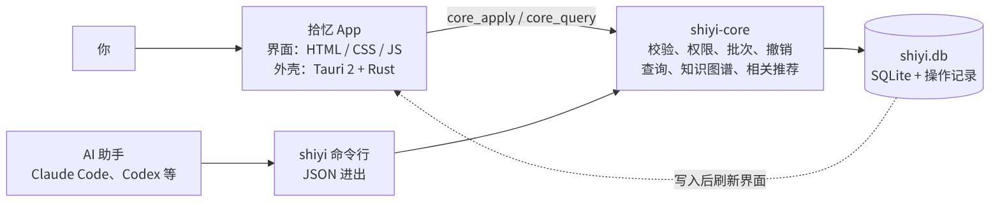
</picture>

- 所有写入都经过 `shiyi-core`：先校验，再检查权限，然后整批写入（要么全部成功，要么全部不生效），同时记下修改前后的快照，所以任何一批都能撤销。
- 界面和命令行打开的是同一个数据库文件。应用会监听其他进程的写入：AI 改了数据，界面会自动刷新，并弹出提示「某某改了几处」。
- 网页预览（不装应用）用的是同一套界面，数据和操作记录存在浏览器里。

## 本地开发

需要 Rust（`rustup`）和 Node 18+。macOS 还要 Xcode Command Line Tools，Windows 还要 Visual Studio 的「C++ 桌面开发」生成工具。

```bash
npm install
npm run dev                                   # 开发模式
npm run build:mac                             # macOS：打包 universal .app 和 .dmg
npm run build                                 # Windows：打包 NSIS 安装包

cd core && cargo test                         # 数据层与命令行的测试
cargo run --bin shiyi -- today --pretty       # 直接用命令行（SHIYI_DB=/tmp/x.db 用测试库）
```

- **只预览界面**：不装 Rust 也行。`cd src && python3 -m http.server`，用浏览器打开即可，数据存在浏览器里。`python3 scripts/build-preview.py` 会把整个前端打成一个单文件页面 `preview/index.html`。
- **端到端测试**：真实界面加真实数据库，再让命令行扮演 AI。先 `cd core && cargo build --bins --examples`，再运行 `python3 scripts/build-preview.py && python3 scripts/e2e/test_app.py`。
- **前后端相似度一致性**：`node scripts/test_related.mjs <数据库副本>`，逐条对比前端和命令行的「可能相关」结果。
- **重新生成 README 截图**：`python3 scripts/screenshots.py`，输出到 `docs/screenshots/`。

日常提交会自动跑测试（`.github/workflows/test.yml`：数据层测试、桌面端编译检查、界面端到端测试；Windows 上也跑数据层测试和编译检查）。

**发布新版本**：先把 `src-tauri/tauri.conf.json`、`src-tauri/Cargo.toml`、`core/Cargo.toml`、`package.json` 里的版本号改成同一个，再在 `docs/releases/vX.Y.Z.md` 写好更新说明，然后推送标签：

```bash
git tag v1.2.0 && git push origin v1.2.0
```

推送标签后会自动编译 macOS（universal）和 Windows 版本，并发布到 Releases，附带 dmg、zip 和 Windows 安装包。标签和应用版本号不一致时会直接报错。

不想打标签时，在 Actions → Build apps 里点 Run workflow：「编译哪个平台」可以选 all / macos / windows，勾上「发布到 Releases」就会发布，不勾则安装包只出现在这次运行的附件里。已经发布过的版本可以只选 windows 再补发，不会重编 macOS。

## 目录结构

```
core/                 数据层（Rust）：SQLite、操作与撤销、知识图谱、相关推荐、shiyi 命令行
  src/model.rs        条目类型、字段，以及对宽松输入的校验与纠正
  src/ops.rs          写操作、批次、权限、撤销、修改摘要
  src/query.rs        today / list / get / search / log / doctor / snapshot
  src/graph.rs        知识图谱（显式关联 + 字段 + [[双链]] + 标签）
  src/related.rs      可能相关（字的二元组 + TF-IDF，不调 AI）
  src/cli.rs          命令行
  src/install.rs      命令行启动脚本（sh / cmd）、home 目录、PATH 提示
  tests/              数据层、命令行、相关推荐、修改摘要的测试
skills/shiyi/         给 AI 的技能说明（SKILL.md，也编进了应用）
src/                  界面（无构建步骤）
  js/core.js          状态、渲染循环、详情面板、设置
  js/store.js         唯一的写入通道：应用里写数据库，网页预览里写浏览器
  js/graph.js         知识图谱、双链、关联
  js/related.js       可能相关（与 core/src/related.rs 一致）
  js/agent.js         操作记录、AI 接入设置
  js/views-main.js    今日 / 灵感 / 项目
  js/kanban.js  gantt.js  burndown.js  pert.js  mindmap.js  ai.js
src-tauri/            Rust 外壳：接入 core、监听 AI 的修改、安装命令行和技能、AI 代理、导入导出、全局快捷键
  tauri.conf.json     macOS 的窗口和打包配置
  tauri.windows.conf.json  Windows 的覆盖配置（系统标题栏、NSIS 安装包）
scripts/              预览打包、端到端测试、截图
docs/                 README 截图（screenshots/）、架构图、每个版本的发布说明（releases/）
.github/workflows/    test.yml 日常测试；build.yml 编译 macOS 和 Windows 并发布
```
